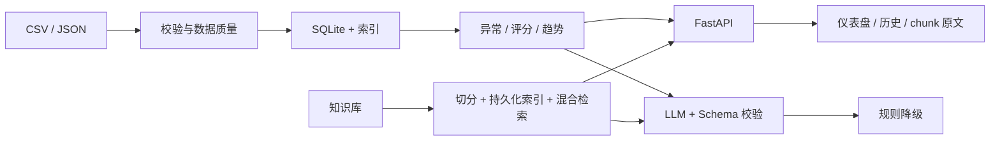

# 半导体设备生产分析与异常识别平台

一个使用**模拟生产数据**构建的设备数据分析、异常识别、RAG 知识助手和
受控大模型报告系统，重点展示从原始文件到可解释 API、页面和 AI 输出的
完整工程链路。

> 本项目未接入真实 MES、SCADA、传感器或工艺配方。所有设备、批次、阈值、
> 知识文档和评估问题均为模拟内容，不代表真实晶圆厂生产经验。

## 架构



详细架构见 [ARCHITECTURE.md](docs/ARCHITECTURE.md)。

## 核心能力

- 外部 CSV/JSON 经字段、范围、设备编号、工艺、时间和批次唯一性校验。
- SQLite 增量同步、兼容旧库迁移、设备/批次/时间索引。
- 异常事件、异常批次、健康评分、逐事件扣分和批次累计趋势统一口径。
- 分页、排序白名单、时间范围过滤和统一 API envelope。
- 语义段落切分、稳定 chunk_id、持久化向量索引、向量 + BM25 混合检索。
- DeepSeek JSON 输出、Pydantic Schema、设备/批次/chunk 引用校验。
- LLM 断网、无 key 或持续非法输出时降级为确定性规则报告。
- 诊断引用可点击查看知识 chunk 原文。
- 结构化日志、request_id、统一异常和调用统计。

## 快速开始

### Make

```bash
make install
make run
```

### Windows 无 Make

```powershell
python -m pip install -r requirements-dev.txt
python scripts/dev.py run
```

### Docker

```bash
docker compose up --build
```

打开：

- 仪表盘：`http://127.0.0.1:8000/dashboard`
- Swagger：`http://127.0.0.1:8000/docs`

## 主要接口

| 接口 | 用途 |
|---|---|
| `GET /healthz` | 存活检查 |
| `GET /api/data-source` | 数据源和记录数 |
| `GET /api/data-quality` | 数据质量与拒绝原因 |
| `GET /api/production/records` | 分页、排序、设备与时间过滤 |
| `GET /api/equipment` | 全部设备摘要 |
| `GET /api/equipment/{id}/analysis` | 异常、评分、阈值与扣分明细 |
| `GET /dashboard` | 设备仪表盘 |
| `GET /health/{id}` | 健康评分接口 |
| `GET /health_history/{id}` | 批次累计趋势 |
| `GET /diagnose/{id}` | 结构化 LLM 报告与引用（只读，不写历史） |
| `POST /diagnose/{id}` | 生成报告并写入诊断历史 |
| `GET /history` | 诊断历史 |
| `GET /diagnosis_detail/{id}` | 报告、引用和生成方式 |
| `GET /api/knowledge/search` | 混合知识检索 |
| `GET /api/knowledge/status` | 索引清单 |
| `GET /knowledge/chunk/{id}` | 知识原文 |
| `GET /api/llm-stats` | LLM 成功率、降级率、延迟和 token |

旧接口成功响应保持兼容；错误响应保留 `detail`，并增加稳定 `error.code`、
`request_id`。新记录接口使用 `data/meta` envelope。

## 数据链路

1. 读取 `data/production_data.csv` 或 `PRODUCTION_DATA_FILE` 指定的 JSON。
2. 逐行校验；坏记录不会进入 SQLite。
3. 文件内容哈希变化时在事务内同步查询缓存。
4. `config/analysis_rules.json` 提供全局、设备类型和单设备阈值。
5. 页面、API、趋势和报告共用同一份确定性分析结果。

字段与数据质量说明：

- [data/README.md](data/README.md)
- [DATA_QUALITY_AND_RULES.md](docs/DATA_QUALITY_AND_RULES.md)

## RAG 与 LLM

RAG 主链路：

```text
知识文档 -> 语义切分 -> chunk 元数据 -> 向量索引
        -> 向量 + BM25 -> top-k + 阈值 -> chunk_id 引用
```

LLM 主链路：

```text
确定性事实 + 检索上下文 + Prompt模板 + JSON Schema
    -> DeepSeek
    -> Schema/设备/批次/chunk校验
    -> 修复一次
    -> 规则降级
```

详细说明：

- [RAG_PIPELINE.md](docs/RAG_PIPELINE.md)
- [LLM_CONTROL.md](docs/LLM_CONTROL.md)

## 可复现指标

| 指标 | 当前结果 | 测量方法 |
|---|---:|---|
| 自动化测试 | 72 / 72 通过 | `python scripts/dev.py check` |
| 核心分析行覆盖率 | 86.47% | 标准库 `trace`，阈值 80% |
| 30 条 RAG recall@3 | 1.0 | `make rag-eval` |
| RAG 真实模型 P95 | 约 13.15 ms | 30 条评估，排除首次构建 |
| RAG 负例 no-match | 5 / 5 | 固定无关问题 |
| 100k 设备分页 P95 | 约 24.48 ms | `scripts/bench_scale.py` |
| 100k 时间范围 P95 | 约 19.06 ms | `scripts/bench_scale.py` |

指标会受机器负载影响。测量定义和边界见 [METRICS.md](docs/METRICS.md)。

## 测试

```bash
make lint
make test
make rag-regression
```

Windows：

```powershell
python scripts/dev.py check
```

CI RAG 回归使用确定性 Embedding，无需下载模型；发布前可通过
`make rag-eval` 运行真实语义模型评估。

测试分层和当前覆盖边界见 [TESTING.md](docs/TESTING.md)。

## 工程结构

```text
app/
├── api/          FastAPI 路由、日志、异常
├── data/         数据校验、SQLite、查询、诊断历史
├── analysis/     外部规则、异常、评分、趋势
├── rag/          切分、索引、混合检索、管线
└── llm/          Prompt、Schema、LLM、降级
config/           规则配置
prompts/          诊断 Prompt
evaluations/      固定 RAG 问题集
scripts/          learn / tools / benchmark / CI
templates/        页面
```

根目录同名 Python 模块是兼容入口，生产实现以 `app/` 为准。

## 项目文档

- [架构与数据流](docs/ARCHITECTURE.md)
- [3 分钟演示脚本](docs/DEMO_SCRIPT.md)
- [指标与复现方法](docs/METRICS.md)
- [简历 bullet 与面试问答](docs/RESUME.md)
- [测试与评估](docs/TESTING.md)
- [关键决策记录](docs/DECISIONS.md)
- [P0 审计基线](docs/AUDIT_BASELINE.md)

## 适用边界

适合：

- 个人作品集和面试技术讨论；
- 中小规模工业数据与 AI 应用流程验证；
- RAG、结构化 LLM 输出和降级策略学习。

不适合：

- 直接控制真实生产设备；
- 未经工程师确认的维修、参数调整或良率决策；
- 声称替代真实 MES/SPC 系统；
- 将模拟指标解释为真实工厂收益。
