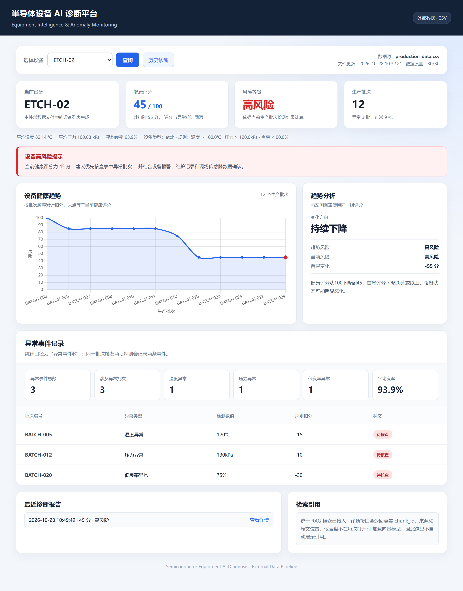
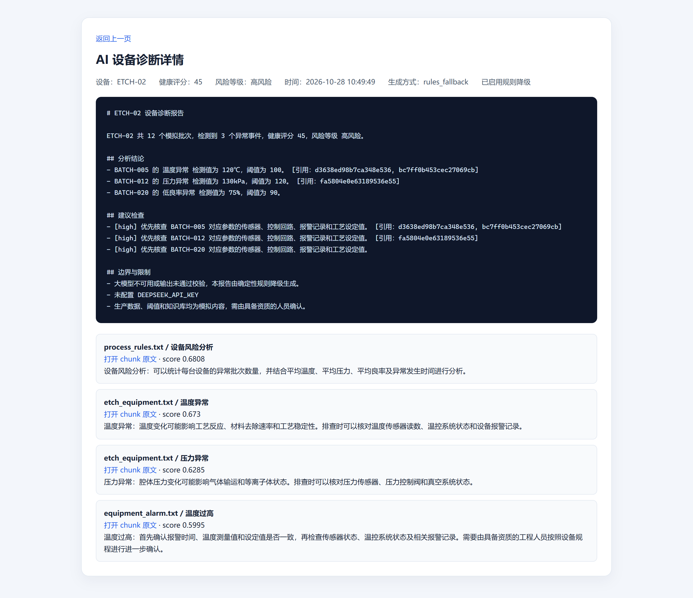
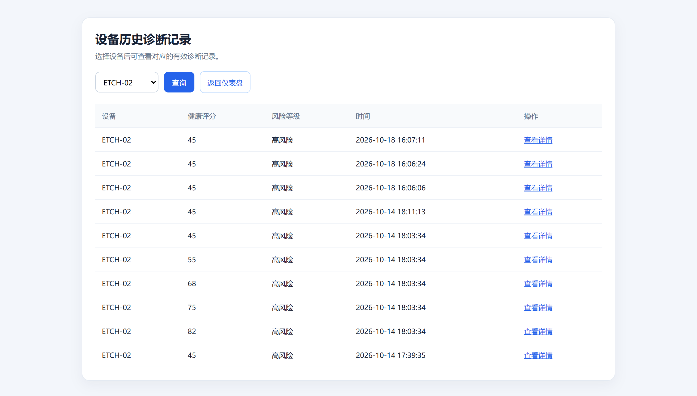
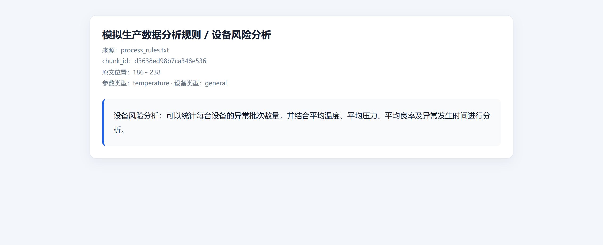
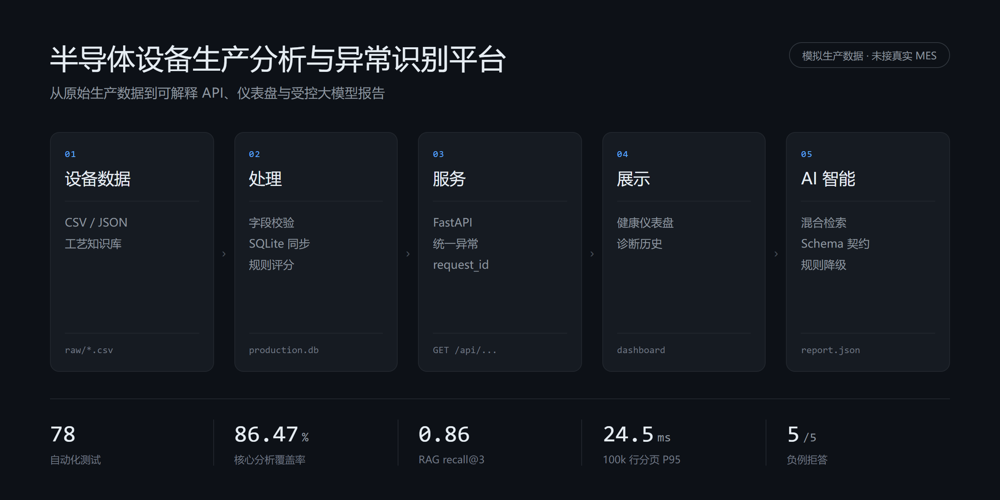

# 半导体设备生产分析与异常识别平台

[](https://github.com/xmn3102220898-spec/semiconductor-analysis/actions/workflows/ci.yml)


一个使用**模拟生产数据**构建的设备数据分析、异常识别、RAG 知识助手和
受控大模型报告系统，重点展示从原始文件到可解释 API、页面和 AI 输出的
完整工程链路。

> 本项目未接入真实 MES、SCADA、传感器或工艺配方。所有设备、批次、阈值、
> 知识文档和评估问题均为模拟内容，不代表真实晶圆厂生产经验。

## 界面

设备仪表盘：健康评分、逐事件扣分、批次趋势与异常记录同源。



诊断详情：报告正文里的引用标记可回溯到真实 chunk，下方列出检索得分与原文入口。
截图中的 `rules_fallback` 是未配置模型密钥时的确定性降级路径，属预期行为。



| 诊断历史 | 知识片段原文 |
|---|---|
|  |  |

## 架构



五层结构与各层产出物：原始 CSV/JSON 与知识库 → 校验和 SQLite 同步 → 规则评分
→ FastAPI → 仪表盘。AI 支线独立于主链路，只读规则事实，不参与评分。

数据流、RAG 与 LLM 的时序图、存储细节，以及可复制的 mermaid 文本版结构图，
都在 [ARCHITECTURE.md](docs/ARCHITECTURE.md)。

## 核心能力

- 外部 CSV/JSON 经字段、范围、设备编号、工艺、时间和批次唯一性校验。
- SQLite 增量同步、兼容旧库迁移、设备/批次/时间索引。
- 异常事件、异常批次、健康评分、逐事件扣分和批次累计趋势统一口径。
- 分页、排序白名单、时间范围过滤和统一 API envelope。
- 语义段落切分、稳定 chunk_id、持久化向量索引、向量 + BM25 混合检索。
- DeepSeek JSON 输出、Pydantic Schema、设备/批次/chunk 引用校验。
- LLM 断网、无 key 或持续非法输出时降级为确定性规则报告。
- 诊断引用可点击查看知识 chunk 原文。
- 结构化日志、request_id、统一异常和调用统计。

## 快速开始

### Make

```bash
make install
make run
```

### Windows 无 Make

```powershell
python -m pip install -r requirements-dev.txt
python scripts/dev.py run
```

### Docker

```bash
docker compose up --build
```

打开：

- 仪表盘：`http://127.0.0.1:8000/dashboard`
- Swagger：`http://127.0.0.1:8000/docs`

## 主要接口

| 接口 | 用途 |
|---|---|
| `GET /healthz` | 存活检查 |
| `GET /api/data-source` | 数据源和记录数 |
| `GET /api/data-quality` | 数据质量与拒绝原因 |
| `GET /api/production/records` | 分页、排序、设备与时间过滤 |
| `GET /api/equipment` | 全部设备摘要 |
| `GET /api/equipment/{id}/analysis` | 异常、评分、阈值与扣分明细 |
| `GET /dashboard` | 设备仪表盘 |
| `GET /health/{id}` | 健康评分接口 |
| `GET /health_history/{id}` | 批次累计趋势 |
| `GET /diagnose/{id}` | 结构化 LLM 报告与引用（只读，不写历史） |
| `POST /diagnose/{id}` | 生成报告并写入诊断历史 |
| `GET /history` | 诊断历史 |
| `GET /diagnosis_detail/{id}` | 报告、引用和生成方式 |
| `GET /api/knowledge/search` | 混合知识检索 |
| `GET /api/knowledge/status` | 索引清单 |
| `GET /knowledge/chunk/{id}` | 知识原文 |
| `GET /api/llm-stats` | LLM 成功率、降级率、延迟和 token |

旧接口成功响应保持兼容；错误响应保留 `detail`，并增加稳定 `error.code`、
`request_id`。新记录接口使用 `data/meta` envelope。

## 数据链路

1. 读取 `data/production_data.csv` 或 `PRODUCTION_DATA_FILE` 指定的 JSON。
2. 逐行校验；坏记录不会进入 SQLite。
3. 文件内容哈希变化时在事务内同步查询缓存。
4. `config/analysis_rules.json` 提供全局、设备类型和单设备阈值。
5. 页面、API、趋势和报告共用同一份确定性分析结果。

字段与数据质量说明：

- [data/README.md](data/README.md)
- [DATA_QUALITY_AND_RULES.md](docs/DATA_QUALITY_AND_RULES.md)

## RAG 与 LLM

RAG 主链路：

```text
知识文档 -> 语义切分 -> chunk 元数据 -> 向量索引
        -> 向量 + BM25 -> top-k + 阈值 -> chunk_id 引用
```

LLM 主链路：

```text
确定性事实 + 检索上下文 + Prompt模板 + JSON Schema
    -> DeepSeek
    -> Schema/设备/批次/chunk校验
    -> 修复一次
    -> 规则降级
```

详细说明：

- [RAG_PIPELINE.md](docs/RAG_PIPELINE.md)
- [LLM_CONTROL.md](docs/LLM_CONTROL.md)

## 可复现指标

| 指标 | 当前结果 | 测量方法 |
|---|---:|---|
| 自动化测试 | 78 / 78 通过 | `python scripts/dev.py check` |
| 核心分析行覆盖率 | 86.47% | 标准库 `trace`，阈值 80% |
| 知识库规模 | 20 篇 / 102 chunk | `knowledge_base/` |
| 50 题 RAG recall@3 | 0.86（recall@1 0.80） | `make rag-eval` |
| RAG 检索 P95 | 约 15.6 ms | 50 题评估，确定性嵌入器，排除首次构建 |
| RAG 负例 no-match | 5 / 5 | 固定无关问题 |
| 100k 设备分页 P95 | 约 24.48 ms | `scripts/bench_scale.py` |
| 100k 时间范围 P95 | 约 19.06 ms | `scripts/bench_scale.py` |

指标会受机器负载影响。测量定义和边界见 [METRICS.md](docs/METRICS.md)。

## 检索评估是怎么做的

这一节回答一个问题：`recall@3 = 0.86` 是怎么算出来的，能信到什么程度。

一句话版：50 道手工题、标注到**段落**而不是文档、两套判定口径同报告输出、
CI 只认确定性嵌入器；当前 recall@3 0.86，最大短板是改写题 0.375，
而失败方式主要是**拒答**而不是编造答案。

### 1. 评估集：50 题，手工标到段落

`evaluations/rag_questions.json`，每题一条记录：

```json
{
  "id": "t02",
  "category": "temperature",
  "question": "批次温度读到 120 度，报告里说要先核对什么",
  "sources": ["process_rules.txt"],
  "expected_sections": ["温度异常规则"],
  "parameter_type": "temperature",
  "keywords": ["温度异常"]
}
```

7 个类别对应不同的检索难度，不是随机抽样：

| 类别 | 题数 | 考察什么 |
|---|---:|---|
| temperature / pressure / yield | 8 / 7 / 5 | 单参数、单文档，基础召回 |
| equipment | 12 | 按设备类型定位故障段落 |
| distractor | 6 | 语料里有大量相似段落，能否不被带偏 |
| multi_hop | 4 | 一段答案需要两处证据（如先停线、再复机） |
| paraphrase | 8 | 用工程口语改写，与文档用词不重叠 |

### 2. 判定口径：段落级，不是文档级

`_is_relevant()` 要求两条同时成立：chunk 来自 `sources` 指定文档，**并且**
`section` 落在 `expected_sections` 里。同文档的其它段落不算命中。

这是刻意收紧的。文档级判定会让「命中 process_rules.txt 就算对」成立，
而检索真正的难点是落到**对的那一段**；落到同文档的错误段落，
下游 LLM 会照着错的段落写报告。

### 3. 为什么换口径：上一版的 1.0 是算出来的

3 篇文档 / 16 个 chunk / 30 题的版本曾记录 recall@1/@3/@5 全为 1.0。
那是结构性满分：候选 chunk 数与 top_k 同阶，等于从 16 个里挑 5 个，
而每题只标了 1 篇文档。扩到 20 篇 / 102 chunk 后，同一套代码的 recall@3 是
0.86——下降不是能力退化，是分母终于有了区分度。旧数字已废弃，不再引用。

旧的文档级口径（文档 + 参数类型 + 关键词子串）仍保留在同一份报告里，
输出为 `legacy_*` 字段，只做对照，不参与门禁。

### 4. 结果

| 指标 | 值 |
|---|---:|
| recall@1 / @3 / @5 | 0.80 / 0.86 / 0.88 |
| MRR | 0.8317 |
| 负例 no-match（5 个无关问题） | 5 / 5 |
| 旧口径 recall@3（仅对照） | 0.82 |

分类 recall@3：

| 类别 | recall@3 |
|---|---:|
| equipment / pressure / yield / distractor | 1.000 |
| temperature | 0.875 |
| multi_hop | 0.750 |
| paraphrase | 0.375 |

### 5. 短板：改写题 0.375，而且失败方式是拒答

8 道改写题里 5 道未命中，其中 **4 道直接返回空结果**：

| 题号 | 用户说法 | 文档用词 | 结果 |
|---|---|---|---|
| q01 | 片子热场读数和设定值对不上 | 温度异常 | 拒答 |
| q03 | 连续跑几小时后对位越来越差 | 热漂移 | 拒答 |
| q04 | 洗完的片子干了以后留下印子 | 水痕 | 拒答 |
| q07 | 同一片测两次结果差很多 | 重复性 | 拒答 |

根因在拒答判据。检索用 idf 加权查询词覆盖度决定是否作答：`coverage >= 0.25`
才允许仅凭关键词通过，否则要求向量分 ≥ 0.5 兜底（`app/rag/retrieval.py`）。
工程口语与文档用词零重叠时覆盖度为 0，确定性嵌入器又给不出足够高的向量分，
系统选择拒答。

这是有意的取舍——**拒答可以补一次追问，答错会直接写进诊断报告。**
代价是改写类召回被压到 0.375。换真实语义模型（`--embedder semantic`）能缓解
词面不重叠，但评测机未安装 torch，本仓库不给出未复测的数字。

另外 2 道失败不是拒答，是段落选错：

- `t02`「批次温度读到 120 度，报告里说要先核对什么」标注为
  process_rules.txt / 温度异常规则，实际 top1 是 cvd_equipment.txt / 温度均匀性
  （0.569 vs 0.509）。两段都在讲温度，但一段讲**规则**、一段讲**均匀性**。
- `q08`「产线要不要停，按什么标准判断」标注为 alarm_escalation.txt / 停线条件，
  实际 top1 是 cvd_equipment.txt / 边界与限制。停线在后者里只是一句带过，
  没有独立段落，说明 `section` 标题还没参与打分。

下一步是把 section 标题并入召回打分，而不是继续调阈值——阈值只能决定
「答不答」，改不了「答哪段」。

### 6. 门禁为什么是 0.80 而不是 0.85

CI 用确定性嵌入器跑回归（`make rag-regression`），门禁 `--fail-under 0.80`。
最初设 0.85，语料扩容后一次失败；但那次失败暴露的是改写题的真实短板，
不是回归缺陷。把门禁降到 0.80 并在本节写明原因，比悄悄调低阈值更诚实：
0.80 卡住的是「别把已经做到的能力丢掉」，0.85 会逼着为了过线去改评估集。

复现：

```bash
make rag-regression     # 确定性嵌入器，CI 同款，约 1.7 s
make rag-eval           # 真实语义模型，需先装 sentence-transformers
```

报告写入 `output/rag_evaluation.json`，含每题的首命中位次与 top5 明细。

## 测试

```bash
make lint
make test
make rag-regression
```

Windows：

```powershell
python scripts/dev.py check
```

CI RAG 回归使用确定性 Embedding，无需下载模型；发布前可通过
`make rag-eval` 运行真实语义模型评估。

测试分层和当前覆盖边界见 [TESTING.md](docs/TESTING.md)。

## 工程结构

```text
app/
├── api/          FastAPI 路由、日志、异常
├── data/         数据校验、SQLite、查询、诊断历史
├── analysis/     外部规则、异常、评分、趋势
├── rag/          切分、索引、混合检索、管线
└── llm/          Prompt、Schema、LLM、降级
config/           规则配置
prompts/          诊断 Prompt
evaluations/      固定 RAG 问题集
scripts/          learn / tools / benchmark / CI
templates/        页面
```

根目录同名 Python 模块是兼容入口，生产实现以 `app/` 为准。

## 项目文档

- [架构与数据流](docs/ARCHITECTURE.md)
- [3 分钟演示脚本](docs/DEMO_SCRIPT.md)
- [指标与复现方法](docs/METRICS.md)
- [简历 bullet 与面试问答](docs/RESUME.md)
- [测试与评估](docs/TESTING.md)
- [关键决策记录](docs/DECISIONS.md)
- [P0 审计基线](docs/AUDIT_BASELINE.md)

## 适用边界

适合：

- 个人作品集和面试技术讨论；
- 中小规模工业数据与 AI 应用流程验证；
- RAG、结构化 LLM 输出和降级策略学习。

不适合：

- 直接控制真实生产设备；
- 未经工程师确认的维修、参数调整或良率决策；
- 声称替代真实 MES/SPC 系统；
- 将模拟指标解释为真实工厂收益。

## 许可证

[MIT](LICENSE)。代码可自由使用、修改和商用，保留版权声明即可。

注意：`knowledge_base/`、`data/` 与 `evaluations/` 中的内容均为本项目编写的
模拟材料，不对应任何真实工厂的工艺文档或生产数据。
