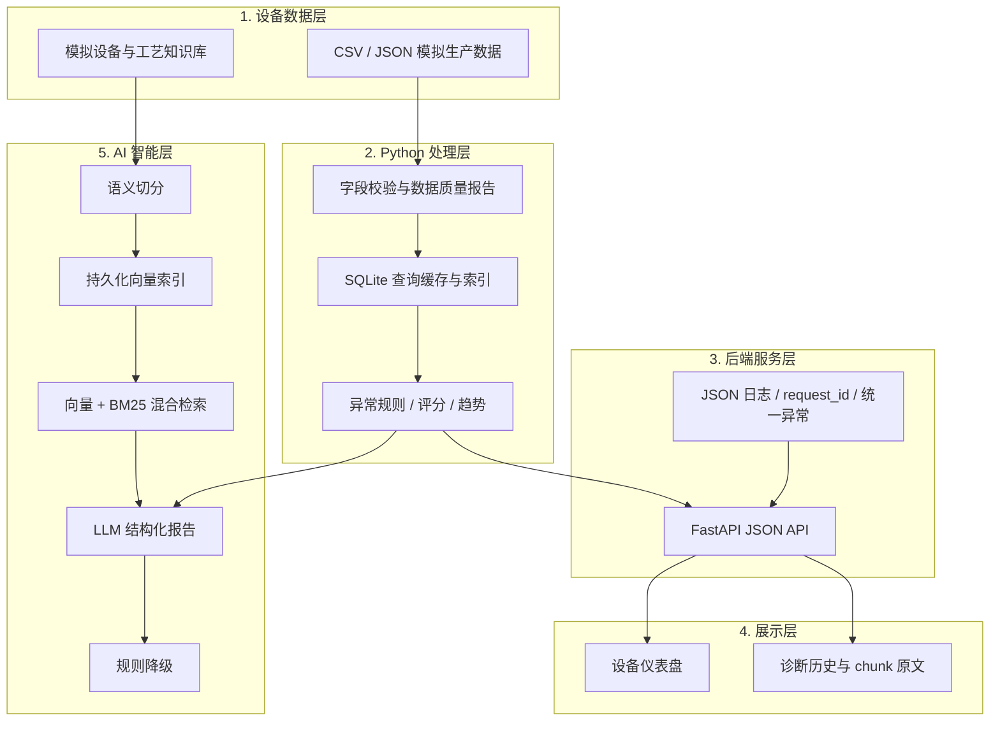
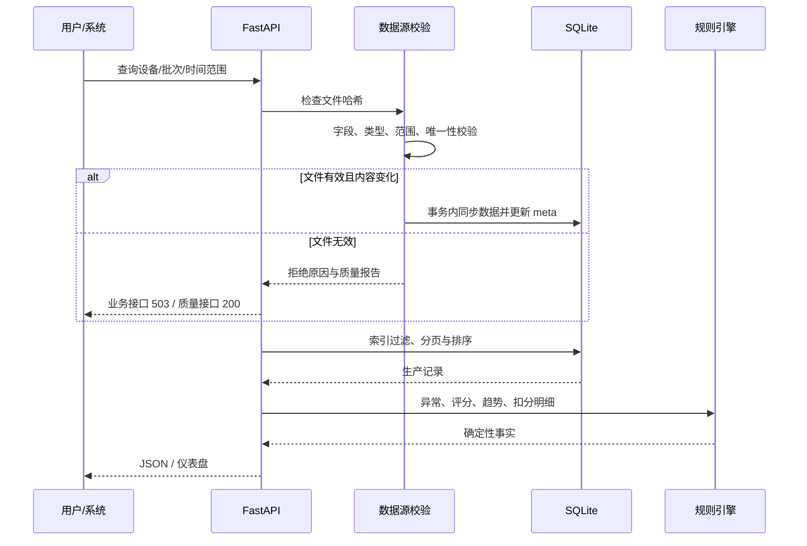
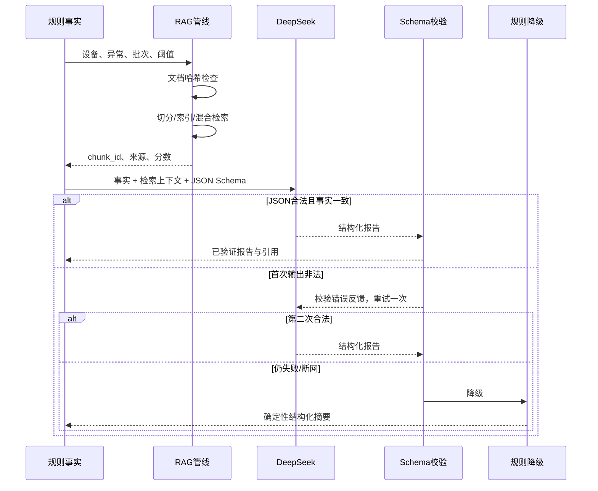

# 系统架构

## 1. 定位

这是一个使用模拟生产数据构建的半导体设备生产分析与异常识别平台，
用于展示数据处理、SQL、API、规则分析、RAG 和大模型输出控制的工程实现。
它不是真实 MES、SCADA 或晶圆厂生产系统。

## 2. 五层架构

## 3. 数据处理流

## 4. RAG 与 LLM 流

## 5. 存储

### 生产数据

`database/production.db`

- `wafer_production`
- `data_source_meta`
- 索引：设备、批次、生产时间、设备+时间

### 诊断与模型统计

`diagnosis_history.db`

- `diagnosis_history`
- `llm_call_stats`

旧库使用增量 `ALTER TABLE`，不删除历史数据。

### RAG 索引

`data/rag_index/`

- `manifest.json`
- `chunks.json`
- `vectors.npy`

索引由文件内容哈希触发刷新；当前规模采用 NPY 精确检索，不引入外部向量数据库。

## 6. 关键设计决策

完整记录见 [DECISIONS.md](DECISIONS.md)。

- 结构化事实只来自确定性规则模块。
- 页面不调用 LLM，避免打开仪表盘产生费用和外部依赖。
- LLM 只能组织语言和提供初步检查方向，不得修改评分。
- 脏数据不使用旧库冒充当前结果。
- 排序字段使用白名单，避免 SQL 注入。
- 旧 API 保持兼容，新记录接口使用 `data/meta` envelope。
- RAG 使用向量 + BM25，并用负例控制无关召回。

## 7. 边界与扩展

适用：

- 个人作品集和面试技术演示；
- 中小规模模拟工业数据分析；
- RAG/LLM 输出控制教学。

不适用：

- 真实晶圆厂生产控制；
- 高频时序采集和 SCADA 实时闭环；
- 大规模并发向量检索；
- 不经人工确认的维修或工艺调整。
